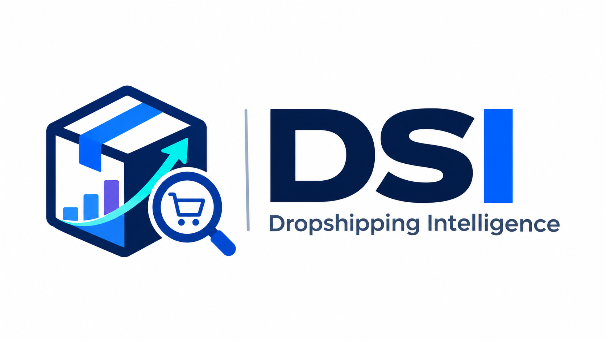
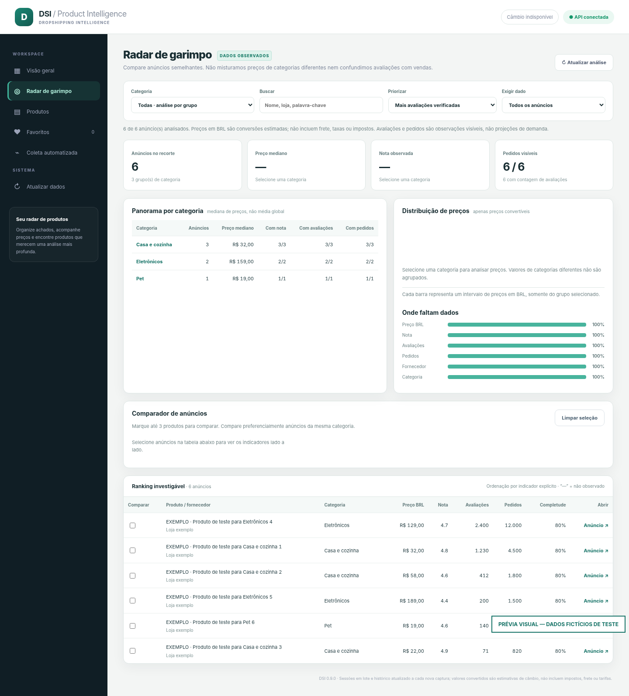
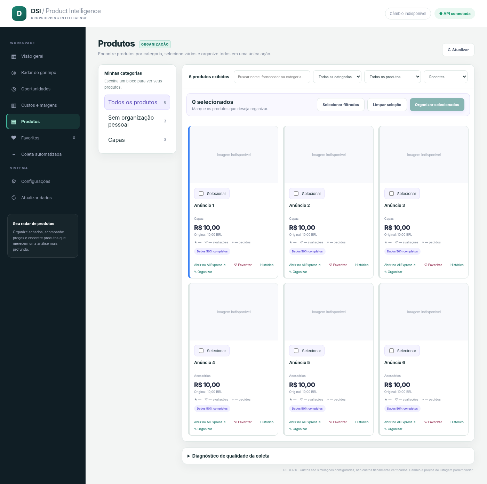
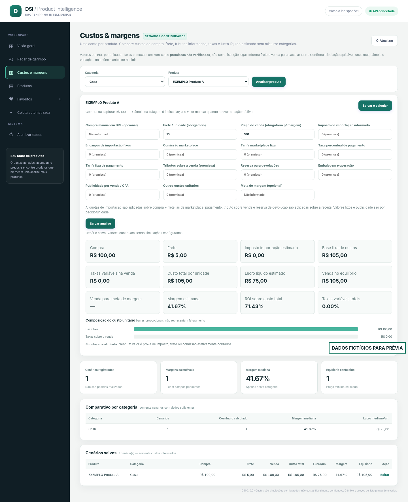
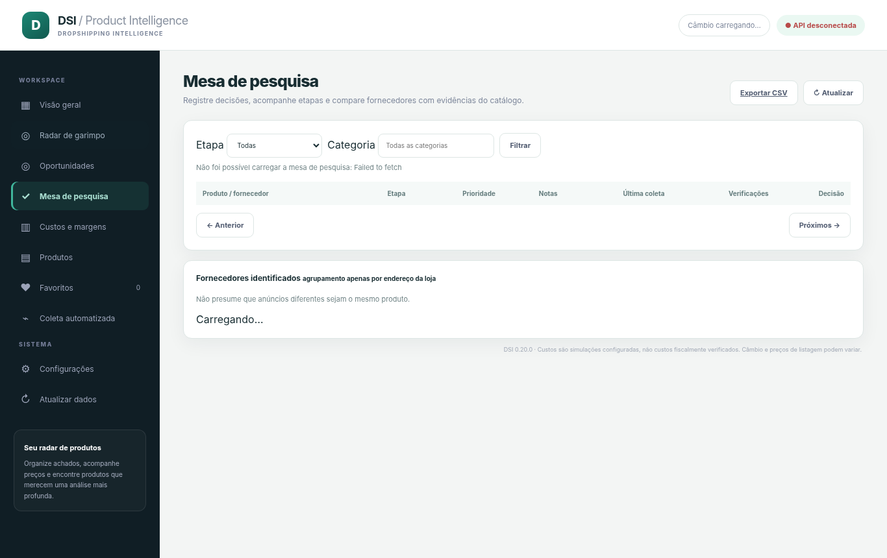

<p align="center">
  
</p>

<h1 align="center">DSI — Dropshipping Intelligence</h1>

<p align="center">
  Pesquisa e inteligência de produtos para dropshipping com uma extensão Firefox, uma API local e um dashboard de análise.
</p>

<p align="center">
  
  
  
  
  
  
</p>

> [!IMPORTANT]
> **Status: candidata de lançamento (v1.0.0).** A extensão ainda não está assinada/publicada na Mozilla e faltam testes finais de ponta a ponta em Windows + Firefox + AliExpress. Este repositório não é afiliado ao AliExpress.

## O que é o DSI?

O **DSI (Dropshipping Intelligence)** é uma aplicação **local** de apoio ao garimpo, catalogação e avaliação comercial de anúncios, começando pelo AliExpress. Durante a navegação, a extensão Firefox identifica dados presentes na página e os envia, mediante pareamento, a uma API FastAPI executada no próprio computador. Um dashboard reúne o catálogo, os custos estimados, o histórico e as decisões de pesquisa.

O propósito é ajudar a responder: **quais anúncios investigar, quais dados estão faltando, quanto uma operação *poderia* render e quais verificações precisam ser feitas antes de testar um produto?**

### Funcionalidades principais

| Módulo | O que oferece |
| --- | --- |
| **Coleta Firefox** | Captura individual e lotes de até 40 anúncios já carregados na página; ignora novas coletas em lote do mesmo produto por 24 h |
| **Produtos** | Catálogo, favoritos, busca, categorias personalizadas, cores, renomeação e organização em lote |
| **Radar** | Comparações dentro de categorias, cobertura de dados, avaliações, pedidos informados e faixas de preço |
| **Histórico** | Registros de preços, mudanças observadas e alertas relacionados |
| **Custos e Margens** | Simulação de compra, frete, taxas, tributos informados, preço de venda, margem, ROI e cenários de estresse |
| **Oportunidades** | Triagem por margem simulada, informações faltantes e ações para prosseguir com a pesquisa |
| **Mesa de Pesquisa** | Etapas de investigação, prioridades, checklist, observações e evidências declaradas pelo usuário |
| **Configurações** | Pareamento local, backup SQLite, exportação CSV, verificação de integridade e limpeza confirmada |

> [!NOTE]
> O DSI distingue **informação observada**, **dado ausente** e **premissa de simulação**. Avaliações, pedidos e informações de fornecedores podem não estar disponíveis em todos os layouts; **estimativas de margem não são garantia de lucro**.

## Interface

As imagens abaixo são **prévias de desenvolvimento com dados de demonstração**, registradas em versões anteriores. O visual e os recursos exibidos podem diferir da candidata v1.0.

<details open>
<summary><strong>Radar de garimpo</strong> — categorias, indicadores e comparação</summary>



</details>

<details>
<summary><strong>Produtos</strong> — filtros e organização em blocos</summary>



</details>

<details>
<summary><strong>Custos e margens</strong> — simulações por anúncio</summary>



</details>

<details>
<summary><strong>Mesa de Pesquisa</strong> — acompanhamento e verificação</summary>



</details>

## Fluxo de trabalho

```text
Navegar no AliExpress
         ↓
Capturar anúncios com a extensão
         ↓
Organizar por categorias e revisar campos ausentes
         ↓
Comparar dados, custos e oportunidades
         ↓
Registrar verificações na Mesa de Pesquisa
         ↓
Decidir: investigar / testar / aprovar / descartar
```

## Começando no Windows

**Requisitos:** Windows, **Python 3.10 ou superior** e Firefox. O pacote local ainda **não** é um instalador Windows nativo nem assinado.

1. Obtenha os arquivos do **projeto local** e o pacote de desenvolvimento da extensão na distribuição do projeto. Não há link oficial de download nem release publicado configurado neste README.
2. Extraia o projeto. Se estiver atualizando uma instalação existente, **faça backup de `data/dsi.db` e preserve toda a pasta `data/`**.
3. Na primeira execução, abra **`Instalar e iniciar DSI.bat`**. Nas próximas, use **`Iniciar DSI.bat`**.
4. Acesse **http://127.0.0.1:8000/dashboard**. Mantenha aberta a janela que executa o servidor.
5. Para diagnosticar problemas de inicialização, execute **`Diagnosticar DSI.bat`** e consulte [`SOLUCAO_DE_PROBLEMAS.md`](SOLUCAO_DE_PROBLEMAS.md), quando disponível no projeto principal.

### Carregando e conectando a extensão no Firefox (teste)

A extensão v1.0.0 **ainda não é assinada** para instalação permanente. Para testes locais:

1. Abra `about:debugging` → **Este Firefox** → **Carregar extensão temporária**.
2. Selecione o arquivo `manifest.json` na pasta `extension/` extraída do projeto.
3. Com o aplicativo local funcionando, abra **Configurações** no dashboard e copie a chave de pareamento.
4. Abra o popup da extensão, informe a chave e conecte.
5. Visite uma página do AliExpress e realize uma captura de teste. Para lotes posteriores, role a página e atualize a lista de anúncios identificados.

A coleta progressiva considera os anúncios **já presentes na página**; não força carregamento de itens por rolagem automática e não deve contornar restrições de acesso do site.

## Arquitetura

```text
extension/           Firefox WebExtension (JavaScript)
    ↕ HTTP local autenticado
backend/             Python + FastAPI
    ↕
data/dsi.db          SQLite (dados locais; não versionar)
    ↑
dashboard/           HTML + CSS + JavaScript
```

### Tecnologias

**Python, FastAPI, SQLite, HTML, CSS, JavaScript e Firefox WebExtensions.** A extensão comunica-se com a API local em `127.0.0.1:8000` e utiliza uma chave de pareamento. Este modelo não substitui a necessidade de manter navegador, sistema e dependências atualizados.

## Privacidade, segurança e limitações

- A API é projetada para rodar **localmente**, não para exposição pública na rede.
- **Nunca envie para o GitHub:** `data/dsi.db`, backups, tokens, chaves de pareamento, `.venv/`, logs privados ou arquivos de configuração com segredos.
- A captura depende da apresentação e dos dados visíveis/estruturados nas páginas do AliExpress. Alguns campos podem permanecer vazios ou variar por região.
- Nota do anúncio e avaliação do fornecedor são informações distintas.
- Impostos, frete, comissões e demais despesas precisam ser confirmados ou configurados antes de tomar decisões comerciais.
- Utilize a extensão em conformidade com os termos de uso das plataformas acessadas e com a legislação aplicável.
- Consulte [`PRIVACIDADE.md`](PRIVACIDADE.md) e [`PUBLICACAO.md`](PUBLICACAO.md) no projeto completo para detalhes e checklist de distribuição.

## Estado de lançamento e próximos passos

A versão **1.0.0 é uma release candidate**. Antes de anunciar disponibilidade pública, ainda são necessários testes reais no Windows/Firefox/AliExpress, revisão de licenças e permissões, validação do pacote Firefox, identificador definitivo da extensão e **assinatura pela Mozilla**.

**Próximas evoluções previstas:** comparação de anúncios equivalentes, melhor navegação em catálogos grandes, análise da proveniência dos dados e monitoramento mais refinado — sujeitas a validação técnica.

## Contribuições e licença

Sugestões, relatórios de bugs e contribuições são bem-vindos conforme a política do mantenedor. **A licença ainda deve ser definida pelo proprietário antes da divulgação como código open source.** Não presuma que este projeto usa MIT ou outra licença sem um arquivo `LICENSE` válido no repositório.

---

<p align="center"><strong>DSI — mais evidências, menos achismos no garimpo de produtos.</strong></p>
